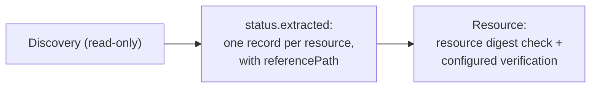

## Goal

Generate `Resource` objects for the resources a `Discovery` finds — including
resources in nested components — so they are verified before anything consumes
them.

## You'll end up with

- A `Discovery` that publishes one record per resource, each carrying the
  `referencePath` to the component that owns it.
- `Resource` objects, one per record, that reach `Ready` only after the
  controller verifies them.

**Estimated time:** ~15 minutes

## Prerequisites

- [Controller environment]() set up
- A `Ready` [Component]()
  in the same namespace whose component version references other components
- Already comfortable with [discovering component graphs]()
- kro ≥ 0.9 for the automated variant below


A `Discovery` is read-only: it resolves descriptors and projects them into its
status, but it checks no signature and no digest. Do not deploy from the
accesses in `status.extracted`. Create `Resource` objects instead. With the
default `verificationPolicy: Always`, the Resource controller checks the resource
digest. Root signatures are checked when configured; nested component digests
are checked when supplied by their references. `Ready` alone is not a signature
verification policy. See [Verify Component Signatures on Deployment]().


## How it works

A `Discovery` resolves the transitive graph of its root `Component` and projects
each surviving resource into `status.extracted`. The new `referencePath` binding
gives you, per record, the shortest chain of component reference identities from
the root component to the component that owns the resource. That value is exactly
what a `Resource` needs in `spec.resource.byReference.referencePath`, so each
record maps one-to-one onto a `Resource`.



The path is computed on the whole graph before any selector runs, so a selector
that drops an intermediate component never cuts the path to a resource below it.

## Steps




### Create and push the component version

This component nests a chart two levels deep: the root references `platform`,
which references `chart`, which carries the `helm-resource`. Create a
`component-constructor.yaml`:

```bash
cat > component-constructor.yaml << 'EOF'
components:
  - name: acme.org/releasechannel
    version: "1.0.0"
    provider:
      name: acme.org
    componentReferences:
      - name: platform
        componentName: acme.org/platform
        version: "1.0.0"
  - name: acme.org/platform
    version: "1.0.0"
    provider:
      name: acme.org
    componentReferences:
      - name: chart
        componentName: acme.org/platform/chart
        version: "1.0.0"
  - name: acme.org/platform/chart
    version: "1.0.0"
    provider:
      name: acme.org
    resources:
      - name: helm-resource
        type: helmChart
        version: "1.0.0"
        access:
          type: ociArtifact
          imageReference: "ghcr.io/stefanprodan/charts/podinfo:6.9.1"
EOF
```

Build and push every component version:

```bash
ocm add cv --repository $OCM_REPO
```




### Create a Discovery that extracts reference paths

The `Discovery` selects the chart resource and projects a record whose
`referencePath` points at the owning nested component. Set `componentRef.name`
to your `Component`:

```bash
cat > discovery.yaml << 'EOF'
apiVersion: delivery.ocm.software/v1alpha1
kind: Discovery
metadata:
  name: helm-charts
  namespace: default
spec:
  componentRef:
    name: releasechannel
  resourceSelector:
    matchIdentity:
      name: helm-resource
  extract:
    byResources:
      name: '(component.name + "-" + resource.name).replace("/", "-").replace(".", "-")'
      resource: '{"name": resource.name}'
      referencePath: referencePath
EOF
kubectl apply -f discovery.yaml
```

Wait until the `Discovery` is ready and its payload is current — a failed
`Discovery` keeps its last successful result, so `Ready=True` alone is not
enough:

```bash
kubectl get discovery helm-charts -o jsonpath='{.status.conditions[?(@.type=="Ready")].status} {.status.observedGeneration} {.metadata.generation}{"\n"}'
```

Then inspect the records:

```bash
kubectl get discovery helm-charts -o jsonpath='{.status.extracted}' | jq
```

You should see one record whose `referencePath` walks the two nested references:

```json
[
  {
    "name": "acme-org-platform-chart-helm-resource",
    "referencePath": [{ "name": "platform" }, { "name": "chart" }],
    "resource": { "name": "helm-resource" }
  }
]
```




### Create the Resource objects

`componentRef` must be the **same** `Component` as the `Discovery`'s
`componentRef`: the reference path starts at that root.




Copy `resource` and `referencePath` from one record into a `Resource`:

```bash
cat > resource.yaml << 'EOF'
apiVersion: delivery.ocm.software/v1alpha1
kind: Resource
metadata:
  name: acme-org-platform-chart-helm-resource
  namespace: default
spec:
  componentRef:
    name: releasechannel
  resource:
    byReference:
      resource:
        name: helm-resource
      referencePath:
        - name: platform
        - name: chart
EOF
kubectl apply -f resource.yaml
```




A kro `forEach` turns each record into a `Resource`, so the set stays in sync
with the `Discovery`:

```yaml
apiVersion: kro.run/v1alpha1
kind: ResourceGraphDefinition
metadata:
  name: discovery-resources
spec:
  schema:
    apiVersion: v1alpha1
    kind: DiscoveryResources
    spec:
      prefix: string | default="charts"
  resources:
    - id: discovery
      readyWhen:
        - ${discovery.status.conditions.exists(c, c.type == "Ready" && c.status == "True")}
      template:
        apiVersion: delivery.ocm.software/v1alpha1
        kind: Discovery
        metadata:
          name: "${schema.spec.prefix}-discovery"
        spec:
          componentRef:
            name: releasechannel
          resourceSelector:
            matchIdentity:
              name: helm-resource
          extract:
            byResources:
              name: '(component.name + "-" + resource.name).replace("/", "-").replace(".", "-")'
              resource: '{"name": resource.name}'
              referencePath: referencePath
    - id: charts
      forEach:
        - rec: ${discovery.status.extracted}
      template:
        apiVersion: delivery.ocm.software/v1alpha1
        kind: Resource
        metadata:
          name: ${schema.spec.prefix + '-' + rec.name}
        spec:
          componentRef:
            name: releasechannel
          resource:
            byReference:
              resource: ${rec.resource}
              referencePath: ${rec.referencePath}
```

Apply it, then create an instance:

```bash
cat > instance.yaml << 'EOF'
apiVersion: kro.run/v1alpha1
kind: DiscoveryResources
metadata:
  name: charts
  namespace: default
spec:
  prefix: charts
EOF
kubectl apply -f instance.yaml
```







### Confirm the Resources are verified

```bash
kubectl get resources
kubectl get resource acme-org-platform-chart-helm-resource -o jsonpath='{.status.conditions[?(@.type=="Ready")]}' | jq
```

A `Ready=True` condition with the message `Applied version 1.0.0` means the
controller resolved the resource and published its access under the configured
verification policy. For the kro variant, the name also has the `charts-` prefix.




## Deploy a verified product release with operator-owned profiles

The [discovery-localization example](https://github.com/frewilhelm/open-component-model/tree/feat/discovery-reference-path/bindings/go/kubernetes/controller/examples/discovery-localization)
demonstrates discovery-driven deployment of a connected observability product: podinfo serves the application,
Prometheus scrapes it, and Grafana presents the results.

The component graph has a root (`example.com/observability-demo:1.0.0`) that references three product
components. Each product carries a pinned upstream chart and one or more image resources with exact digest pins.

| Product CV | Version | Resources |
| --- | --- | --- |
| `example.com/products/podinfo` | `6.9.1` | `chart`, `image` |
| `example.com/products/prometheus` | `29.47.0` | `chart`, `server-image`, `config-reloader-image` |
| `example.com/products/grafana` | `14.4.0` | `chart`, `image` |

### Discovery-driven deployment with supplied product profiles

Two Discoveries project one record per product resource with a one-hop `referencePath` (the product alias
in the root's component references). Inventory predicates in the RGD require exactly the expected set of
charts and images before the instance reaches Ready:

```yaml
# Chart discovery: exactly three records, one per product alias
- ${size(chartDiscovery.status.extracted) == 3}
- ${chartDiscovery.status.extracted.all(rec, size(rec.referencePath) == 1)}
- ${chartDiscovery.status.extracted.exists(rec, rec.product == "podinfo")}

# Image discovery: exactly four product/resource pairs
- ${size(imageDiscovery.status.extracted) == 4}
- ${imageDiscovery.status.extracted.exists(rec, rec.product == "prometheus" && rec.name == "server-image")}
```

The full inventory must match before any deployment values are published. Removing an image or supplying
an unexpected record keeps the instance in a pending state rather than producing an empty deployment.

### Operator-owned profiles replace label-driven discovery

Instead of inferring Helm value paths from resource labels, the operator ships the full product profiles as
kro-managed ConfigMaps. Each ConfigMap's `values.yaml` key is assembled from verified Resource status fields:

```yaml
data:
  values.yaml: |
    fullnameOverride: "${schema.spec.prefix}-podinfo"
    image:
      repository: "${images.filter(i, i.metadata.name == schema.spec.prefix + '-podinfo-image')[0].status.additional.registry + '/' + ...repository}"
      tag: "${...tag + '@' + ...digest}"
```

The `[0]` selector is safe here because the exact-pair inventory predicates and Resource readiness gates
guarantee the image exists and is verified before the ConfigMap is evaluated. Do not use `[0]` as an
unqualified first-image shortcut in a graph where the count is not fixed.

Each product has its own values ConfigMap (`<prefix>-podinfo-values`, `<prefix>-prometheus-values`,
`<prefix>-grafana-values`). Each HelmRelease's `valuesFrom` is built by filtering the three ConfigMaps to
the one whose `discovery.ocm.software/product` label matches the OCIRepository:

```yaml
valuesFrom: >-
  ${dyn([podinfoValues, prometheusValues, grafanaValues].filter(v,
    v.metadata.labels["discovery.ocm.software/product"] == source.metadata.labels["discovery.ocm.software/product"]
  ).map(v, {"kind": "ConfigMap", "name": v.metadata.name, "valuesKey": "values.yaml"}))}
```

These actual node references enforce creation order: the HelmRelease cannot be created until its values
ConfigMap exists, which cannot be created until all image Resources are verified. Arbitrary new products
require an operator values profile; there is no fallback that installs an unknown chart with upstream defaults.

### Run the product release example

Use the example files from this branch with the existing development-cluster prerequisites (Docker, OCM CLI,
Task, Helm, kind, kubectl, Flux CLI). Set up the development cluster if needed:

```bash
# From the repository root
task bindings/go/kubernetes/controller:test/e2e/setup/local
```

Then run the single launcher command:

```bash
task --dir bindings/go/kubernetes/controller/examples/discovery-localization run
```

The launcher prepares pinned chart archives, builds and publishes the CVs, applies bootstrap and RGD,
then waits for the instance and all three HelmReleases to be Ready.

Inspect what was deployed:

```bash
# Verified Resources: seven (three charts + four images)
kubectl -n default get resources.delivery.ocm.software \
  -l discovery.ocm.software/instance=discovery-localization -o wide

# OCI sources and Helm releases
kubectl -n default get ocirepositories,helmreleases \
  -l discovery.ocm.software/instance=discovery-localization

# Read the generated Grafana admin password (never passed through logs or arguments)
kubectl -n default get secret discovery-localization-grafana \
  -o jsonpath='{.data.admin-user}' | base64 -d && echo
kubectl -n default get secret discovery-localization-grafana \
  -o jsonpath='{.data.admin-password}' | base64 -d && echo

# Port-forward and open the Podinfo Observability dashboard
kubectl -n default port-forward service/discovery-localization-grafana 3000:80
# open http://localhost:3000/d/podinfo-observability
```

Log in with the credentials above. The dashboard shows scrape availability and scraped sample count for the
podinfo target, sourced from the Prometheus instance deployed in the same namespace.

The dedicated e2e test runs the full flow and asserts split CV placement, all seven verified resource
identities, three distinct upstream chart workloads with the four expected mirror digest pins, and live
Prometheus results through authenticated Grafana queries:

```bash
task bindings/go/kubernetes/controller:test/e2e -- --focus="Discovery Cross-Repository Localization" --procs=1
```

## Troubleshooting

### Symptom: `resource with identity … not found in component`

**Cause:** The resource carries an `extraIdentity`, so addressing it by `name`
alone does not match.

**Fix:** Build `resource` with every extra-identity key:

```yaml
resource: '{"name": resource.name, "platform": resource.extraIdentity.platform}'
```

### Symptom: `component reference with identity … not found … at reference path step N`

**Cause:** The record is stale — the `Discovery` is not `Ready`, or it has not
re-reconciled since the root component changed.

**Fix:** Wait for the readiness check from step 2 (`Ready=True` and
`observedGeneration == generation`) before creating `Resource` objects from the
records.

### Symptom: `status.extracted` is `[]`

**Cause:** The selectors matched nothing.

**Fix:** Loosen the selectors; see [Discover Component Graphs]().

### Symptom: A record has no `referencePath` field

**Cause:** It was projected in `expression` mode, which does not bind
`referencePath`.

**Fix:** Use `byResources` (or `byComponents`) so the binding is available.

## Next steps

- [Deploy a Helm Chart with kro and GitOps]()
- [Verify Component Signatures on Deployment]()

## Related documentation

- [Concept: Component Discovery]()
- [Reference: Component]()
