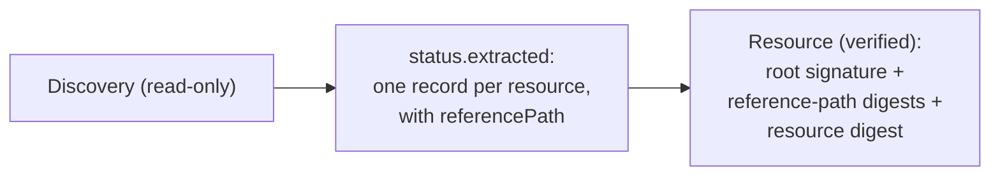

## Goal

Generate `Resource` objects for the resources a `Discovery` finds — including
resources in nested components — so they are verified before anything consumes
them.

## You'll end up with

- A `Discovery` that publishes one record per resource, each carrying the
  `referencePath` to the component that owns it.
- `Resource` objects, one per record, that reach `Ready` only after the
  controller verifies them.

**Estimated time:** ~15 minutes

## Prerequisites

- [Controller environment]() set up
- A `Ready` [Component]()
  in the same namespace whose component version references other components
- Already comfortable with [discovering component graphs]()
- kro ≥ 0.9 for the automated variant below


A `Discovery` is read-only: it resolves descriptors and projects them into its
status, but it checks no signature and no digest. Do not deploy from the
accesses in `status.extracted`. Create `Resource` objects instead — the
`Resource` controller verifies the root signature, the digest at every
reference-path hop, and the resource digest before exposing an access.


## How it works

A `Discovery` resolves the transitive graph of its root `Component` and projects
each surviving resource into `status.extracted`. The new `referencePath` binding
gives you, per record, the shortest chain of component reference identities from
the root component to the component that owns the resource. That value is exactly
what a `Resource` needs in `spec.resource.byReference.referencePath`, so each
record maps one-to-one onto a `Resource`.



The path is computed on the whole graph before any selector runs, so a selector
that drops an intermediate component never cuts the path to a resource below it.

## Steps




### Create and push the component version

This component nests a chart two levels deep: the root references `platform`,
which references `chart`, which carries the `helm-resource`. Create a
`component-constructor.yaml`:

```bash
cat > component-constructor.yaml << 'EOF'
components:
  - name: acme.org/releasechannel
    version: "1.0.0"
    provider:
      name: acme.org
    componentReferences:
      - name: platform
        componentName: acme.org/platform
        version: "1.0.0"
  - name: acme.org/platform
    version: "1.0.0"
    provider:
      name: acme.org
    componentReferences:
      - name: chart
        componentName: acme.org/platform/chart
        version: "1.0.0"
  - name: acme.org/platform/chart
    version: "1.0.0"
    provider:
      name: acme.org
    resources:
      - name: helm-resource
        type: helmChart
        version: "1.0.0"
        access:
          type: ociArtifact
          imageReference: "ghcr.io/stefanprodan/charts/podinfo:6.9.1"
EOF
```

Build and push every component version:

```bash
ocm add cv --repository $OCM_REPO
```




### Create a Discovery that extracts reference paths

The `Discovery` selects the chart resource and projects a record whose
`referencePath` points at the owning nested component. Set `componentRef.name`
to your `Component`:

```bash
cat > discovery.yaml << 'EOF'
apiVersion: delivery.ocm.software/v1alpha1
kind: Discovery
metadata:
  name: helm-charts
  namespace: default
spec:
  componentRef:
    name: releasechannel
  resourceSelector:
    matchIdentity:
      name: helm-resource
  extract:
    byResources:
      name: '(component.name + "-" + resource.name).replace("/", "-").replace(".", "-")'
      resource: '{"name": resource.name}'
      referencePath: referencePath
EOF
kubectl apply -f discovery.yaml
```

Wait until the `Discovery` is ready and its payload is current — a failed
`Discovery` keeps its last successful result, so `Ready=True` alone is not
enough:

```bash
kubectl get discovery helm-charts -o jsonpath='{.status.conditions[?(@.type=="Ready")].status} {.status.observedGeneration} {.metadata.generation}{"\n"}'
```

Then inspect the records:

```bash
kubectl get discovery helm-charts -o jsonpath='{.status.extracted}' | jq
```

You should see one record whose `referencePath` walks the two nested references:

```json
[
  {
    "name": "acme-org-platform-chart-helm-resource",
    "referencePath": [{ "name": "platform" }, { "name": "chart" }],
    "resource": { "name": "helm-resource" }
  }
]
```




### Create the Resource objects

`componentRef` must be the **same** `Component` as the `Discovery`'s
`componentRef`: the reference path starts at that root.




Copy `resource` and `referencePath` from one record into a `Resource`:

```bash
cat > resource.yaml << 'EOF'
apiVersion: delivery.ocm.software/v1alpha1
kind: Resource
metadata:
  name: acme-org-platform-chart-helm-resource
  namespace: default
spec:
  componentRef:
    name: releasechannel
  resource:
    byReference:
      resource:
        name: helm-resource
      referencePath:
        - name: platform
        - name: chart
EOF
kubectl apply -f resource.yaml
```




A kro `forEach` turns each record into a `Resource`, so the set stays in sync
with the `Discovery`:

```yaml
apiVersion: kro.run/v1alpha1
kind: ResourceGraphDefinition
metadata:
  name: discovery-resources
spec:
  schema:
    apiVersion: v1alpha1
    kind: DiscoveryResources
    spec:
      prefix: string | default="charts"
  resources:
    - id: discovery
      readyWhen:
        - ${discovery.status.conditions.exists(c, c.type == "Ready" && c.status == "True")}
      template:
        apiVersion: delivery.ocm.software/v1alpha1
        kind: Discovery
        metadata:
          name: "${schema.spec.prefix}-discovery"
        spec:
          componentRef:
            name: releasechannel
          resourceSelector:
            matchIdentity:
              name: helm-resource
          extract:
            byResources:
              name: '(component.name + "-" + resource.name).replace("/", "-").replace(".", "-")'
              resource: '{"name": resource.name}'
              referencePath: referencePath
    - id: charts
      forEach:
        - rec: ${discovery.status.extracted}
      template:
        apiVersion: delivery.ocm.software/v1alpha1
        kind: Resource
        metadata:
          name: ${schema.spec.prefix + '-' + rec.name}
        spec:
          componentRef:
            name: releasechannel
          resource:
            byReference:
              resource: ${rec.resource}
              referencePath: ${rec.referencePath}
```

Apply it, then create an instance:

```bash
cat > instance.yaml << 'EOF'
apiVersion: kro.run/v1alpha1
kind: DiscoveryResources
metadata:
  name: charts
  namespace: default
spec:
  prefix: charts
EOF
kubectl apply -f instance.yaml
```







### Confirm the Resources are verified

```bash
kubectl get resources
kubectl get resource acme-org-platform-chart-helm-resource -o jsonpath='{.status.conditions[?(@.type=="Ready")]}' | jq
```

A `Ready=True` condition with the message `Applied version 1.0.0` means the
controller resolved the reference path, verified every hop and the resource
digest, and published the access.




## Troubleshooting

### Symptom: `resource with identity … not found in component`

**Cause:** The resource carries an `extraIdentity`, so addressing it by `name`
alone does not match.

**Fix:** Build `resource` with every extra-identity key:

```yaml
resource: '{"name": resource.name, "platform": resource.extraIdentity.platform}'
```

### Symptom: `component reference with identity … not found … at reference path step N`

**Cause:** The record is stale — the `Discovery` is not `Ready`, or it has not
re-reconciled since the root component changed.

**Fix:** Wait for the readiness check from step 2 (`Ready=True` and
`observedGeneration == generation`) before creating `Resource` objects from the
records.

### Symptom: `status.extracted` is `[]`

**Cause:** The selectors matched nothing.

**Fix:** Loosen the selectors; see [Discover Component Graphs]().

### Symptom: A record has no `referencePath` field

**Cause:** It was projected in `expression` mode, which does not bind
`referencePath`.

**Fix:** Use `byResources` (or `byComponents`) so the binding is available.

## Next steps

- [Deploy a Helm Chart with kro and GitOps]()
- [Verify Component Signatures on Deployment]()

## Related documentation

- [Concept: Component Discovery]()
- [Reference: Component]()
