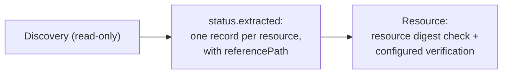

## Goal

Generate `Resource` objects for the resources a `Discovery` finds — including
resources in nested components — so they are verified before anything consumes
them.

## You'll end up with

- A `Discovery` that publishes one record per resource, each carrying the
  `referencePath` to the component that owns it.
- `Resource` objects, one per record, that reach `Ready` only after the
  controller verifies them.

**Estimated time:** ~15 minutes

## Prerequisites

- [Controller environment]() set up
- A `Ready` [Component]()
  in the same namespace whose component version references other components
- Already comfortable with [discovering component graphs]()
- kro ≥ 0.9 for the automated variant below


A `Discovery` is read-only: it resolves descriptors and projects them into its
status, but it checks no signature and no digest. Do not deploy from the
accesses in `status.extracted`. Create `Resource` objects instead. With the
default `verificationPolicy: Always`, the Resource controller checks the resource
digest. Root signatures are checked when configured; nested component digests
are checked when supplied by their references. `Ready` alone is not a signature
verification policy. See [Verify Component Signatures on Deployment]().


## How it works

A `Discovery` resolves the transitive graph of its root `Component` and projects
each surviving resource into `status.extracted`. The new `referencePath` binding
gives you, per record, the shortest chain of component reference identities from
the root component to the component that owns the resource. That value is exactly
what a `Resource` needs in `spec.resource.byReference.referencePath`, so each
record maps one-to-one onto a `Resource`.



The path is computed on the whole graph before any selector runs, so a selector
that drops an intermediate component never cuts the path to a resource below it.

## Steps




### Create and push the component version

This component nests a chart two levels deep: the root references `platform`,
which references `chart`, which carries the `helm-resource`. Create a
`component-constructor.yaml`:

```bash
cat > component-constructor.yaml << 'EOF'
components:
  - name: acme.org/releasechannel
    version: "1.0.0"
    provider:
      name: acme.org
    componentReferences:
      - name: platform
        componentName: acme.org/platform
        version: "1.0.0"
  - name: acme.org/platform
    version: "1.0.0"
    provider:
      name: acme.org
    componentReferences:
      - name: chart
        componentName: acme.org/platform/chart
        version: "1.0.0"
  - name: acme.org/platform/chart
    version: "1.0.0"
    provider:
      name: acme.org
    resources:
      - name: helm-resource
        type: helmChart
        version: "1.0.0"
        access:
          type: ociArtifact
          imageReference: "ghcr.io/stefanprodan/charts/podinfo:6.9.1"
EOF
```

Build and push every component version:

```bash
ocm add cv --repository $OCM_REPO
```




### Create a Discovery that extracts reference paths

The `Discovery` selects the chart resource and projects a record whose
`referencePath` points at the owning nested component. Set `componentRef.name`
to your `Component`:

```bash
cat > discovery.yaml << 'EOF'
apiVersion: delivery.ocm.software/v1alpha1
kind: Discovery
metadata:
  name: helm-charts
  namespace: default
spec:
  componentRef:
    name: releasechannel
  resourceSelector:
    matchIdentity:
      name: helm-resource
  extract:
    byResources:
      name: '(component.name + "-" + resource.name).replace("/", "-").replace(".", "-")'
      resource: '{"name": resource.name}'
      referencePath: referencePath
EOF
kubectl apply -f discovery.yaml
```

Wait until the `Discovery` is ready and its payload is current — a failed
`Discovery` keeps its last successful result, so `Ready=True` alone is not
enough:

```bash
kubectl get discovery helm-charts -o jsonpath='{.status.conditions[?(@.type=="Ready")].status} {.status.observedGeneration} {.metadata.generation}{"\n"}'
```

Then inspect the records:

```bash
kubectl get discovery helm-charts -o jsonpath='{.status.extracted}' | jq
```

You should see one record whose `referencePath` walks the two nested references:

```json
[
  {
    "name": "acme-org-platform-chart-helm-resource",
    "referencePath": [{ "name": "platform" }, { "name": "chart" }],
    "resource": { "name": "helm-resource" }
  }
]
```




### Create the Resource objects

`componentRef` must be the **same** `Component` as the `Discovery`'s
`componentRef`: the reference path starts at that root.




Copy `resource` and `referencePath` from one record into a `Resource`:

```bash
cat > resource.yaml << 'EOF'
apiVersion: delivery.ocm.software/v1alpha1
kind: Resource
metadata:
  name: acme-org-platform-chart-helm-resource
  namespace: default
spec:
  componentRef:
    name: releasechannel
  resource:
    byReference:
      resource:
        name: helm-resource
      referencePath:
        - name: platform
        - name: chart
EOF
kubectl apply -f resource.yaml
```




A kro `forEach` turns each record into a `Resource`, so the set stays in sync
with the `Discovery`:

```yaml
apiVersion: kro.run/v1alpha1
kind: ResourceGraphDefinition
metadata:
  name: discovery-resources
spec:
  schema:
    apiVersion: v1alpha1
    kind: DiscoveryResources
    spec:
      prefix: string | default="charts"
  resources:
    - id: discovery
      readyWhen:
        - ${discovery.status.conditions.exists(c, c.type == "Ready" && c.status == "True")}
      template:
        apiVersion: delivery.ocm.software/v1alpha1
        kind: Discovery
        metadata:
          name: "${schema.spec.prefix}-discovery"
        spec:
          componentRef:
            name: releasechannel
          resourceSelector:
            matchIdentity:
              name: helm-resource
          extract:
            byResources:
              name: '(component.name + "-" + resource.name).replace("/", "-").replace(".", "-")'
              resource: '{"name": resource.name}'
              referencePath: referencePath
    - id: charts
      forEach:
        - rec: ${discovery.status.extracted}
      template:
        apiVersion: delivery.ocm.software/v1alpha1
        kind: Resource
        metadata:
          name: ${schema.spec.prefix + '-' + rec.name}
        spec:
          componentRef:
            name: releasechannel
          resource:
            byReference:
              resource: ${rec.resource}
              referencePath: ${rec.referencePath}
```

Apply it, then create an instance:

```bash
cat > instance.yaml << 'EOF'
apiVersion: kro.run/v1alpha1
kind: DiscoveryResources
metadata:
  name: charts
  namespace: default
spec:
  prefix: charts
EOF
kubectl apply -f instance.yaml
```







### Confirm the Resources are verified

```bash
kubectl get resources
kubectl get resource acme-org-platform-chart-helm-resource -o jsonpath='{.status.conditions[?(@.type=="Ready")]}' | jq
```

A `Ready=True` condition with the message `Applied version 1.0.0` means the
controller resolved the resource and published its access under the configured
verification policy. For the kro variant, the name also has the `charts-` prefix.




## Localize images without hardcoding chart value paths

The [discovery-localization example](https://github.com/frewilhelm/open-component-model/tree/feat/discovery-reference-path/bindings/go/kubernetes/controller/examples/discovery-localization)
extends this flow to multiple charts in another repository and multiple images
per release. It uses a local `webservice` chart and the upstream podinfo chart:

| Chart | Image resource | Helm values populated |
| --- | --- | --- |
| webservice | `image-main` (6.9.1) | `main.image.repository`, `main.image.tag` |
| webservice | `image-canary` (6.9.0) | `worker.image.repository`, `worker.image.tag` |
| webservice | `image-unmapped` (6.7.1) | None; reference included in status summary only |
| podinfo | `image-main` (6.7.1) | `image.repository`, `image.tag` |

### Declare where each image belongs

On each image resource that should be injected, the component author declares:

```yaml
labels:
  - name: localization.ocm.software/helm
    signing: true
    value:
      repository: main.image.repository
      tag: main.image.tag
```

This is an **example-local convention**, not a built-in OCM localization API.
`signing: true` includes the label in signing normalization; it does not configure
signature verification by itself. The chart author supplies the value paths —
neither Discovery nor kro can infer arbitrary Helm schemas.

One uniquely named label supplies one repository/tag pair per image. Paths must
be distinct across images within a release, and the chart must actually use them.
Charts taking a single full image reference, a digest field, or different image
value types need an appropriate mapping and projection instead of this pair.
Adding another image with a valid label adds another pair of `valuesFrom` entries;
there is no fixed image count in the RGD. Unlabeled images remain visible in the
per-chart summary without being injected into Helm values.

The fixture uses `image-` resource-name prefixes and unique reference-path leaves
as its chart keys. For a graph where those leaves repeat, choose a unique key that
includes the full owning component/resource identity. Do not correlate arbitrary
graphs by leaf name or collection index.

### Build Flux inputs from verified Resource status

Discovery supplies identities and reference paths. Each generated image Resource
then reads its resolved access and mapping in its own CEL evaluation:

```yaml
additionalStatusFields:
  reference: resource.access.imageReference
  registry: resource.access.toOCI().registry
  repository: resource.access.toOCI().repository
  tag: resource.access.toOCI().tag
  targets: >-
    has(resource.labels) && resource.labels != null
      ? resource.labels.filter(l, l.name == "localization.ocm.software/helm").map(l, l.value)
      : []
```

Do not inject a literal target such as `main.image.repository` as an
`additionalStatusFields` expression — it would be parsed as CEL code. The
expression above reads it as data from the resource label.

kro creates a ConfigMap per labeled image, with `repository` and `tag` data keys
from its Resource status. Annotations carry the corresponding target value paths.
Both image and chart resources carry the same chart-group label. Each HelmRelease
uses the ConfigMap collection as a dependency and builds its list dynamically:

```yaml
valuesFrom: >-
  ${dyn(localizationValues
    .filter(v, v.metadata.labels["discovery.ocm.software/chart"] == source.metadata.labels["discovery.ocm.software/chart"])
    .map(v, [
      {"kind": "ConfigMap", "name": v.metadata.name, "valuesKey": "repository", "targetPath": v.metadata.annotations["localization.ocm.software/repository-path"]},
      {"kind": "ConfigMap", "name": v.metadata.name, "valuesKey": "tag", "targetPath": v.metadata.annotations["localization.ocm.software/tag-path"]}
    ]).flatten())}
```

Here `source` is the current OCIRepository from the deployer collection, carrying
the same group label. `dyn()` permits the generated list through kro's static
check of the HelmRelease schema; Flux and Kubernetes still validate the resulting
entries. This works for variable-length lists inside a resource — kro is not
limited to creating separate resources with `forEach`.

### Run the cross-repository example

Use the example files from this branch, Docker, the OCM CLI on `PATH`, Task, Helm,
kind and kubectl. These commands create the repository's development cluster:

```bash
# From the repository root; use a disposable development environment.
task bindings/go/kubernetes/controller:test/e2e/setup/local
task bindings/go/kubernetes/controller:helm/install
cd bindings/go/kubernetes/controller/examples/discovery-localization

WORK="$(mktemp -d)"
ROOT=ocm.software/ocm-k8s-toolkit/examples/discovery-localization
REPO_A=http://ocm-e2e-image-registry:5000
REPO_B="$REPO_A/discovery-localization-charts"
ocm add cv --repository "$WORK/ctf" --constructor component-constructor.yaml

# Do not transfer recursively: the chart CVs must remain outside repository A.
for component in "$ROOT" "$ROOT/rgd" "$ROOT/platform"; do
  ocm transfer cv "ctf::$WORK/ctf//$component:1.0.0" "$REPO_A"
done
for component in "$ROOT/chart-webservice" "$ROOT/chart-podinfo"; do
  ocm transfer cv "ctf::$WORK/ctf//$component:1.0.0" "$REPO_B" \
    --copy-resources --config uploader.yaml
done

kubectl apply -f bootstrap.yaml
kubectl wait --for=create rgd/discovery-localization --timeout=5m
kubectl wait --for=condition=Ready rgd/discovery-localization --timeout=5m
kubectl apply -f instance.yaml
kubectl wait --for=create discoverylocalization/discovery-localization --timeout=5m
kubectl wait --for=condition=Ready discoverylocalization/discovery-localization --timeout=5m
```

The bootstrap's resolver ConfigMap sends `.../chart-*` component names to
repository B; `policy: Propagate` passes that configuration through the Component
to Discoveries and Resources. Keep this mapping consistent if changing the repo
URLs. No extra Repository or Component CR is needed for each child CV.

`uploader.yaml` publishes the local Helm input as a standalone OCI artifact with
an explicit name, then uses the default OCI uploader for remote charts and images.
Local Helm inputs otherwise have no `referenceName` and remain local blobs.
`--copy-resources` copies images into B too, so the deployed pull locations really
change rather than continuing to point upstream.

Inspect the data that drives the deployments:

```bash
kubectl get resources.delivery.ocm.software \
  -l discovery.ocm.software/chart=discovery-localization-chart-webservice -o json \
  | jq '.items[] | {name: .metadata.name, component: .status.component.component, access: .status.resource.access, additional: .status.additional}'
kubectl get configmap discovery-localization-chart-webservice-images -o yaml
kubectl get helmrelease discovery-localization-chart-webservice-hr -o json \
  | jq '.spec.valuesFrom'
kubectl get pods -o json \
  | jq '.items[] | select(.metadata.name | startswith("discovery-localization-")) | {name: .metadata.name, images: [.spec.containers[].image]}'
```

The custom release has four `valuesFrom` entries (two images), while podinfo has
two. Ready Pods pull versions 6.9.1, 6.9.0 and 6.7.1 from repository B. The summary
also includes the unmapped image, but it has no `valuesFrom` entry. Use
`status.resource.access` for the full artifact location: for nested resources,
`status.component.repositorySpec` currently describes the root repository rather
than the child CV's actual repository. Also, `toOCI().reference` is only the
tag/digest portion, not the full image reference.

The dedicated e2e test runs the same flow and checks CV isolation, exact value
mappings and Ready Pod image references. From the repository root:

```bash
task bindings/go/kubernetes/controller:test/e2e -- --focus="Cross-Repository Localization"
task bindings/go/kubernetes/controller:test/e2e/setup/teardown
```

### Troubleshoot localization

- Empty `targets`: check the exact OCM label name, and distinguish a missing label
  (intentionally status-only) from an incorrectly written one.
- Source-registry image references: check `--copy-resources` and `uploader.yaml`.
- Invalid value path or duplicate mappings: correct the descriptor labels; there
  is no schema inference or conflict resolution in this example.
- A chart needs digest-only or full-reference values: change the label contract
  and ConfigMap projection for that chart interface, rather than forcing it into
  repository/tag fields.

## Troubleshooting

### Symptom: `resource with identity … not found in component`

**Cause:** The resource carries an `extraIdentity`, so addressing it by `name`
alone does not match.

**Fix:** Build `resource` with every extra-identity key:

```yaml
resource: '{"name": resource.name, "platform": resource.extraIdentity.platform}'
```

### Symptom: `component reference with identity … not found … at reference path step N`

**Cause:** The record is stale — the `Discovery` is not `Ready`, or it has not
re-reconciled since the root component changed.

**Fix:** Wait for the readiness check from step 2 (`Ready=True` and
`observedGeneration == generation`) before creating `Resource` objects from the
records.

### Symptom: `status.extracted` is `[]`

**Cause:** The selectors matched nothing.

**Fix:** Loosen the selectors; see [Discover Component Graphs]().

### Symptom: A record has no `referencePath` field

**Cause:** It was projected in `expression` mode, which does not bind
`referencePath`.

**Fix:** Use `byResources` (or `byComponents`) so the binding is available.

## Next steps

- [Deploy a Helm Chart with kro and GitOps]()
- [Verify Component Signatures on Deployment]()

## Related documentation

- [Concept: Component Discovery]()
- [Reference: Component]()
